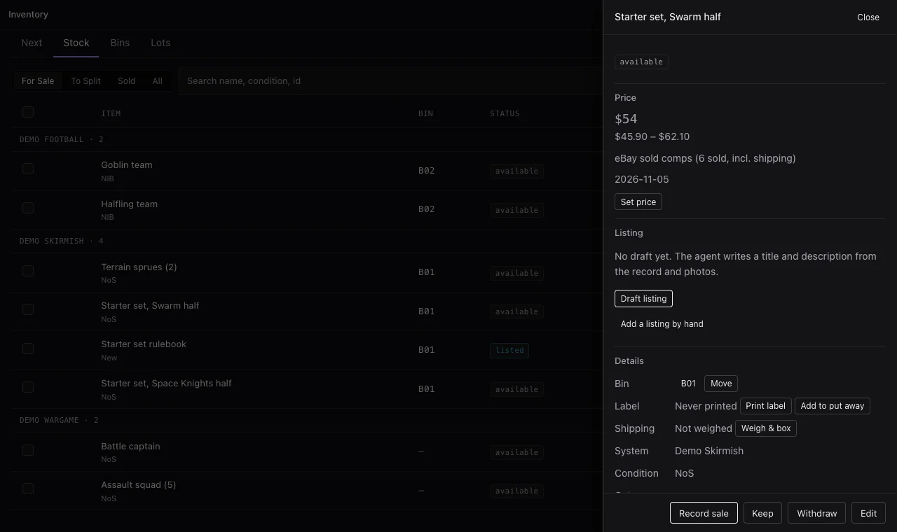

<p align="center">
  
</p>

<p align="center">
  <a href="https://github.com/protoLabsAI/inventory-plugin/actions/workflows/ci.yml"></a>
  <a href="https://github.com/protoLabsAI/inventory-plugin/tags"></a>
  <a href="https://github.com/protoLabsAI/protoAgent"></a>
  
  <a href="LICENSE"></a>
</p>

# Inventory

The back office for a resale business, built as a [protoAgent](https://github.com/protoLabsAI/protoAgent)
plugin. It tracks what you bought, what each box split into, where every piece is on the shelf, what it's
worth, where it's listed and what it actually sold for. Your agent works the inventory with you in chat, and
the Inventory view in the console lets you do it by hand, on a desktop or on your phone.

It was built for tabletop games (sealed boxes broken into units and sold on eBay), but anything you buy in
lots and sell piece by piece fits.

## What you get

- **A work queue.** Next shows what needs you today: sales to pack and which bin they're in, listings to end,
  scans that need a look, items ready to list, boxes still to split, and stock that's sat too long. A section
  only appears when there's something in it.
- **Scan a box in.** Photograph a box and say what you paid. The agent identifies it in the background, lists
  the pieces it splits into, and you choose Keep or Sell for each one.
- **Label first, then put it away.** Print a QR sticker for every piece, then scan a piece's label and the
  bin's label with your phone camera. The piece is now in that bin and up for sale.
- **Bins and labels.** Numbered bins (B01, B02…) with printable QR labels on Avery sheets or thermal rolls.
  Scanning a bin's label opens its contents.
- **Prices with their evidence.** Targets come from eBay sold listings, and every price keeps the basis it
  rests on, so you can always see why something is $54.
- **Listing drafts you paste into eBay.** The agent writes the title and description from the record and the
  photos. You copy them into eBay yourself, then paste the listing link back.
- **Record a sale by pasting it.** Paste an eBay order or a quick note ("sold the dice for $70 + $9 shipping")
  and check what the agent read before it's recorded. If the item was still listed somewhere else, Next tells
  you to end that listing.
- **What to do with stock.** Aging stock suggests an offer, a markdown, a bundle or a decision as items sit.
  When you scan a box, it compares selling it sealed against splitting it, after fees.
- **Packing and shipping data.** Packed weight, box size and your own packaging presets, copied into the
  listing the way eBay asks for them.
- **Check a bin.** Scan everything in a bin and see what's there, what's missing and what's in the wrong bin.
- **Copy list.** Select items and copy a for-sale post for a group chat: the game system as a header, then
  `Name NoS — $20` on each line.
- **Lot P&L.** For every purchase: what it cost, what's left to sell, what's been realized, and the projected
  net if the rest sells at target.

## How it stays honest

- **It never posts, lists or messages anyone.** Drafts and sales are written for you to check and act on.
  There's no eBay write access at all.
- **A price always has a basis.** A target can't be set without saying what it rests on, and the comps are
  stored with it.
- **It doesn't invent facts about items.** Model counts it can't see stay unknown, a box's contents come from
  what it can confirm, and a scan it isn't sure about asks you to pick or type the name.
- **Sold means a sale was recorded.** An item becomes sold only through a sale record, with its price, fees
  and postage, never by flipping a status.
- **Everything is audited.** Every change records who made it (the agent or you in the console) and what
  changed.

## Quick start

1. **Install it** on an agent you already have:

   ```sh
   python -m server plugin install https://github.com/protoLabsAI/inventory-plugin
   ```

   Or in the console: **Plugins → Install from URL**.
2. **Turn it on** in **Console → Plugins**. It ships disabled.
3. **Set the basics** in **Settings → Plugins → Inventory**: the workspace directory, and the weekly review
   if you want it. Every setting is in [configuration.md](docs/configuration.md).
4. **Open Inventory** from the console's rail. Add bins under **Bins**, then **Scan a box**, or import a
  spreadsheet from **More → Import CSV**.

Pricing from sold comps uses the [ebay plugin](https://github.com/protoLabsAI/ebay-plugin). Identifying
photos needs a vision-capable model. A printed label opens its item or bin in the console on protoAgent
0.227.0 or later; on an older host it shows a page naming the bin or item. Full steps are in
[Install and setup](docs/install.md).

## Using it

| To | Say something like, or do |
|---|---|
| See how you're doing | "How are my lots doing?" · open **Lots** |
| Bring in a box | **Scan a box**, photograph it, enter what you paid |
| Put pieces away | **Bins → Put away → Scan with camera**: scan pieces' labels, then the bin's |
| Find something | **Scan label** on a piece or a bin · "Where's the Halfling team?" |
| Price stock | "Re-price everything older than a month from sold comps." |
| List an item | **Draft listing** in its drawer, copy into eBay, then **I listed it** |
| Record a sale | **Record a sale** on Next and paste the order · "Sold the Goblin team for $39, eBay." |
| Pack orders | Next → **To pack**, grouped by bin, then **Packed** |
| Post to a group chat | Select items in **Stock**, then **Copy list** |
| Deal with slow stock | Next → **Aging stock**: Mark down, Bundle or Snooze |

More in [Using it](docs/usage.md).

## Documentation

| Doc | What's in it |
|---|---|
| [Install and setup](docs/install.md) | Requirements, install, the settings that matter, first steps, phones |
| [Using it](docs/usage.md) | Each tab and every flow, step by step |
| [How it works](docs/how-it-works.md) | The data model, the agent turns the plugin starts, labels, the audit trail |
| [Configuration](docs/configuration.md) | Every setting, its default, and what it does |
| [Tools](docs/tools.md) | Every agent tool |
| [HTTP API](docs/api.md) | Every route, operator and public |
| [Design decisions](docs/design-decisions.md) | Why it's built the way it is |
| [Development](docs/development.md) | Layout, tests, the view harness, releasing |
| [Upgrading](docs/upgrading.md) | Notes for versions that change behavior |

## License

MIT, see [LICENSE](LICENSE). The QR encoder is Project Nayuki's QR Code generator (MIT) and the label reader
is jsQR (Apache-2.0); both are vendored unmodified under `vendor/` with their licences.
