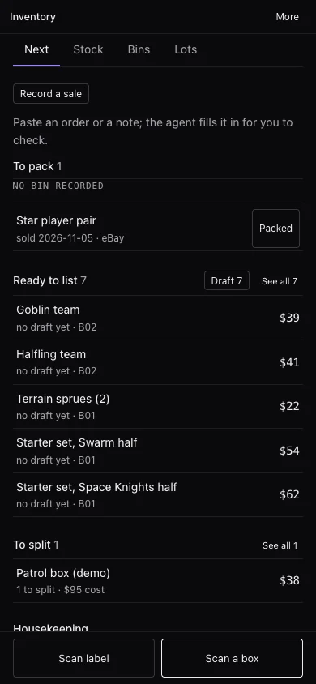

# Using it

Day to day you can ask the agent in chat, or work the **Inventory** view in the console's rail by hand. The
agent's tools are listed in [tools.md](tools.md).

<p align="center">
  
</p>

## The view

The header has **Scan label**, **Scan a box** and **More**. On a phone, the two scan buttons sit at the
bottom of the screen.

**More** holds the occasional jobs: Record a sale, Add item by hand, New lot, New bins, Print bin labels,
Packaging, Import CSV, Export CSV and History (every change, as readable sentences).

Everything about one item lives in its **drawer**: the price with its full basis, the listing draft, the bin,
the label, shipping, the details, and the actions (Record sale, Keep, Withdraw, Return to stock, Edit,
Delete). It opens from the side on a desktop and from the bottom on a phone.

### Next

A work queue. Each section only appears when it has something in it, in this order:

| Section | What's in it |
|---|---|
| **End these listings** | Items that sold somewhere else while still listed on another channel. Open the listing, end it there, then **I ended it** |
| **Sales to check** | Pasted sales the agent has read, waiting for you to check and record |
| **To pack** | Sales not yet packed, grouped by the bin to pull from. **Packed** ticks one off |
| **Needs a look** | Scans that are unsure, failed or unfinished. Each one resumes where you left it |
| **Update the custom label on eBay** | Items that moved bins after you copied their Custom label (SKU) |
| **Copied, not live yet** | Drafts you copied a day ago or more but never marked listed |
| **Aging stock** | Unsold items past an aging tier, with one suggested move each |
| **Ready to list** | Priced, available items with no live listing, with their draft state. **Draft N** drafts several at once |
| **To split** | Lots with planned pieces still to break out |
| **Housekeeping** | Counts: labelled pieces waiting to be put away, unsold items with no bin, missing items, for-sale items with no packed weight, stale prices (with **Ask for a re-price**) |

**Record a sale** sits at the top of Next.

### Stock

Everything you have, grouped by game system the same way Copy list groups it.

- **For sale / To split / Sold / All** switches what's shown. Kept and withdrawn items are under All.
- **Search** matches the name, condition and id. **Filter** narrows by system, lot or bin, and each active
  filter shows as a chip you can remove.
- **Select** rows to **Copy list**, **Move to bin…** or **Print labels**. ⌘C copies too, unless you've
  selected text.

### Bins

One row per bin with its item count, its unsold value at target, and when it was last checked. Open a bin to
see what's in it, **Move items here**, **Check this bin**, **Copy list** or **Print labels**. **Put away**,
**Print labels** and **New bins** are at the top.

### Lots

The P&L. Each lot shows its date, its pieces and its projected net, with a loss marked. A lot's detail has the
four numbers that matter (lot cost, remaining at target, realized net, projected net), its pieces grouped by
state, and its sales. A totals row heads the list.

## Scan a box in

1. **Scan a box**, then choose **New box I bought** or **Single piece**.
2. Take a photo (it opens your phone's camera), say what you paid and, if you like, where from. The lot starts
   right away, named "Box scanned…" until it's identified, so nothing is lost if you walk away.
3. The agent identifies it in the background, usually in under a minute. You don't have to wait on the
   screen.
   - **Sure:** the name, the game system and Looks right.
   - **Not sure:** up to three guesses to pick from, and a field to type the name.
   - **Couldn't tell:** Type the name or Retake photo.
4. **Keep or Sell** each piece. The agent lists the pieces it can confirm. Add more with a photo of a piece.
5. **Price the sell pile.** A second turn prices each piece from eBay sold comps. A piece without enough comps
   stays unpriced, and says why. For a box, it also prices the box sealed and shows **Split** against
   **Sealed**, after fees when it can work them out. If sealed clearly wins, **Sell it sealed instead…**
   turns the pieces back into one sealed item.
6. **Print labels for these pieces.** The last step prints a sticker for each piece you're selling. Then put
   them away.

## Labels

- **Bin labels:** Bins → **Print labels**. Pick all bins, a range, or only the ones without a printed label.
- **Item labels:** select items in Stock and **Print labels**, or **Print label** in an item's drawer, or the
  last step of a scan.
- **Label stock:** Avery 5160 (30 to a sheet, 2⅝″ × 1″), Avery 5163 (10 to a sheet, 4″ × 2″), a Dymo 30252
  address roll (3½″ × 1⅛″), or a 2¼″ × 1¼″ thermal roll. On a sheet, **Start at label** skips labels you've
  already used.
- The sheet opens in your browser: a new tab on the web, your default browser from the desktop app. Print it
  at 100% (actual size).

An item label carries its QR, the name, condition and bin, and the item id. It has no price, because the
price changes and the sticker doesn't.

## Put away

Label first, then bin by scanning:

1. **Bins → Put away**, then **Scan with camera** (or **Take a photo**).
2. Point at a piece's label. The screen flashes, the frame turns green, a beep sounds, and the piece's name
   shows at the top of the camera and at the top of the **Scanned** list right under it (the newest three,
   with a count). A label already in the list turns the frame amber ("Already scanned"); a QR code that
   isn't one of your labels turns it red. Do the same for as many pieces as are going in the same bin.
3. Point at the bin's label and confirm "Put 3 items in B01?". They move into that bin, and a planned piece
   becomes available.

A label that won't read: type the item or bin id. **Weigh** on a piece in the list records its packed weight
and box on the way.

## Scan label

**Scan label** reads any of your labels: an item's opens its drawer, a bin's opens the bin. It uses the live
camera, a photo, or a typed id.

## Check a bin

Open a bin, **Check this bin**, and scan the label on every piece in it. The list shows what's found, what's
not scanned yet, and anything that doesn't belong (in another bin, in no bin, or sold and packed). **Finish
check** moves strays in, can flag the unscanned as missing, and stamps the bin as checked. A missing item
turns up again with a later check, any move, or **Found it** in its drawer.

## Price stock

Ask in chat ("re-price the Blood Bowl teams from sold comps"), or use **Ask for a re-price** under
Housekeeping, which drafts the request in chat for you to send. Or **Set price** in an item's drawer: a
target always needs a basis.

The weekly review, if it's on, re-prices the oldest evidence every Monday and reports listings that have been
up too long.

## List on eBay

1. **Draft listing** in an item's drawer, or **Draft N** on Next ▸ Ready to list (at most 10, one after
   another).
2. Copy the **title** (80 characters at most), **price**, **description**, **Custom label (SKU)** and, if
   you've recorded them, **package weight** and **size**. **Download photos** gets the photos in order.
3. List it on eBay yourself.
4. **I listed it**, and paste the listing address (`ebay.com/itm/…` or the app's share link). The item is now
   listed.

The Custom label is bin first (`B03-<item id>`), so eBay's own pick list and order search show where it is.
If the item moves bins later, Next reminds you to update it on eBay.

## Record a sale

- **Paste it:** **Record a sale** on Next (or More, or "Paste the order instead" in an item's Record sale
  dialog). Paste an eBay order, a Seller Hub row, an app's share text or a note. The agent finds the item and
  proposes the price, shipping charged, fees (marked estimated when they are), postage, channel and date.
  Change anything, then **Record**. Nothing is recorded until you do. A paste that repeats a recorded sale
  says **Already recorded** with a link to the item.
- **By hand:** **Record sale** in an item's drawer.
- **In chat:** "Sold the Goblin team for $39 plus $6 shipping on eBay."

Sold items land on **To pack** with their bin. If the item was also listed on another channel, Next shows it
under **End these listings**.

## Aging stock

Items that haven't sold get one suggestion per tier (45, 90 and 120 days by default): an offer to watchers or
a 10% drop, then another drop or a bundle, then a decision. **Mark down…** opens the Price dialog 10% lower
with a basis filled in. **Bundle…** drafts a chat message asking the agent to propose a bundle. **Snooze 14
days** hides an item until then. Each row says what its days count from: the listing date, or when it became
available if it isn't listed.

## Copy list

Select items in Stock or a bin, then **Copy list**. You get a post for a group chat:

```
Blood Bowl
Halfling team NIB — $41
Goblin team NIB — $39
```

The game system is a header, then one line per item with its condition and a whole-dollar price.

## In chat

| To | Say something like |
|---|---|
| See the P&L | "How are we doing?" · "How did the patrol box do?" |
| Find things | "What's in B02?" · "Where's the star player pair?" |
| Fix a record | "The Halfling team is NIB, not NoS." |
| Price | "Re-price everything with stale evidence." |
| Record a sale | "Sold the rulebook locally for $15." |
| Import | "Import inventory.csv from the workspace." |
